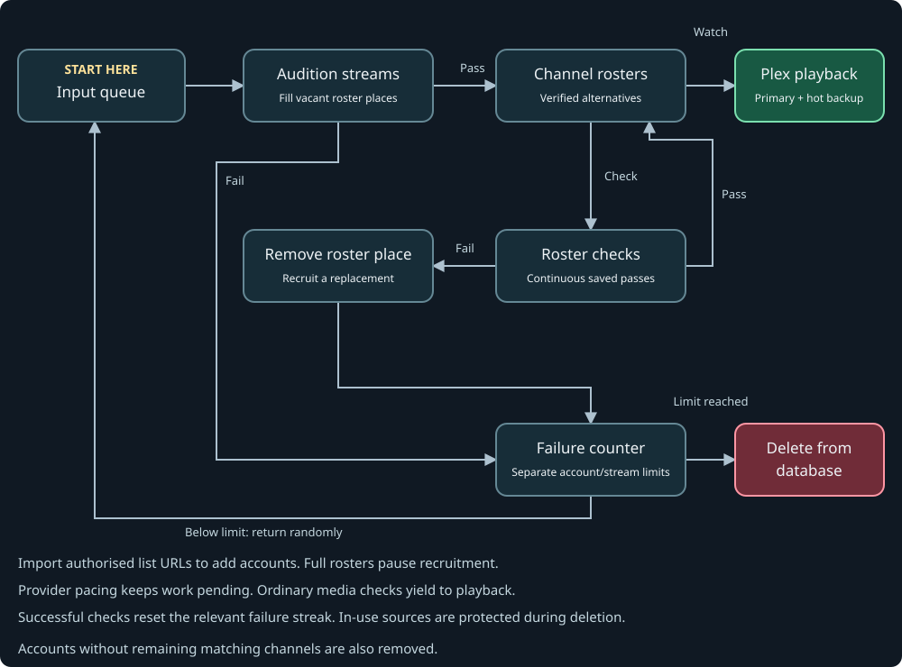
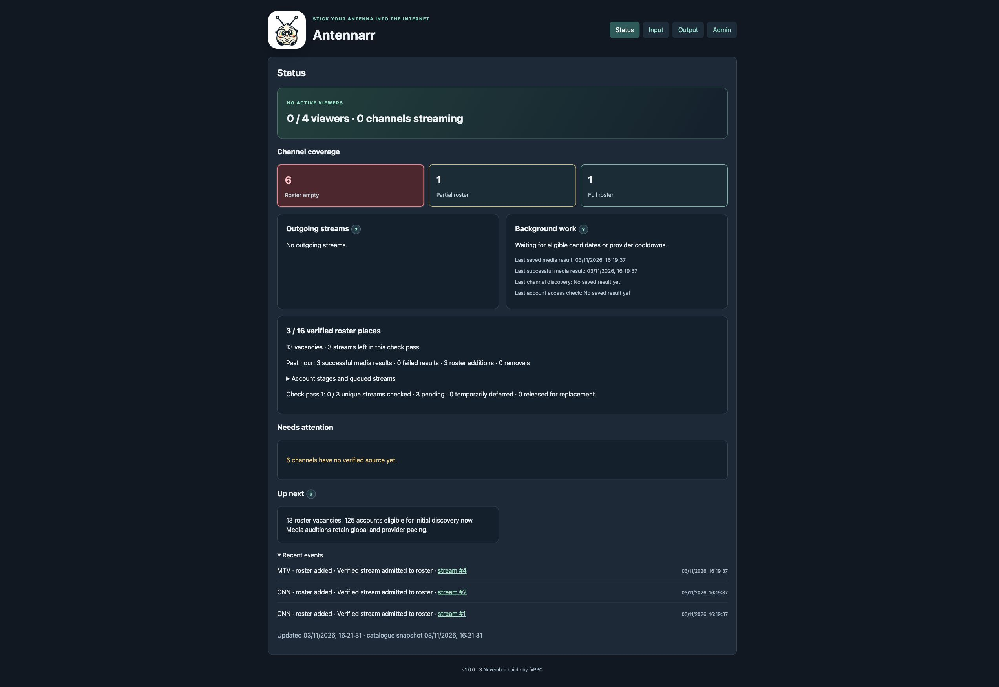

# Antennarr

**Stick your antenna into the Internet.** · by **fxPPC**

**XTREAM account-list URLs in. Stable television channels out.**

Antennarr is a live TV companion to Sonarr and Radarr: they look after your films and series; Antennarr tries to keep live television playing when its sources have other plans. It is an independent project, not an official part of either application.

Built from the bottom up to manage thousands of accounts and source streams, Antennarr imports lists, tests sources, matches streams to your chosen channels, and maintains a pool of confirmed replacements. Plex gets consistent channel identities and tuner URLs while Antennarr deals with the mess upstream. You wanted to watch television, not become a full-time playlist curator.

The aim is stable viewing and recording sessions even when individual sources are unreliable. It cannot conjure a working feed when every source is down, but it can make replacing a failed one somebody else's problem. Specifically, the program's.

[Docker Hub](https://hub.docker.com/r/antennarr/antennarr) · [Releases](https://github.com/fxPPC/Antennarr/releases) · [Setup help](https://github.com/fxPPC/Antennarr/discussions) · [Report a bug](https://github.com/fxPPC/Antennarr/issues/new/choose)

## Three phases, one less thing to babysit

### 1. Turn lists into usable sources

Supply URLs for account-list pages, either plain or Base64-encoded. Antennarr decodes supported encodings, retrieves supported list and paste pages, and picks out provider URLs, usernames, and passwords from the assorted formatting people apparently enjoy inventing. Equivalent accounts are deduplicated and added to the input queue.

It checks account access, retrieves channel catalogues, and tests matching media streams. Channel names, aliases, country information, and negative keywords help match provider variations to your chosen lineup. Checks use connection budgets and provider pacing; a large input queue is not an invitation to hammer a server. Only selected channels receive media checks.

### 2. Build and maintain channel rosters

Working source streams earn places in each channel's **roster**: a configurable pool of confirmed alternatives. Rostered streams are repeatedly re-tested while background checks are allowed to run. Failed entries leave the roster, and replacements are auditioned from the input queue. Once a roster is full, recruitment for that channel stops.

Choose stability or provider diversity, adjust roster targets, and let Antennarr maintain the assignments. The channel stays “CNN” even if its latest provider calls it something considerably more creative.

### 3. Keep the channel playing

When Plex tunes a channel, Antennarr races a configurable set of recent successful candidates. It establishes a primary feed and, when a second working source is available, keeps a **hot backup actively receiving media**. If either falters, Antennarr replaces it; a failed primary can be replaced by the already-running backup without deliberately closing the downstream session.

Video is copied without transcoding. Audio is encoded to consistent AAC, and the output is packaged to help Plex tolerate source switches. Multiple viewers of the same channel share its primary/backup pair; different channels get their own pairs. Optional active-channel replenishment can keep filling roster vacancies during playback.

Plex handles the programme guide and recordings. Antennarr concentrates on feeding it a stable channel. Codec changes, timing jumps, exhausted sources, and client behaviour can still interrupt playback; see [limitations](#upgrades-and-limitations). A hot backup is useful engineering, not a supernatural guarantee.

## Feed flow

The same diagram is available under **Admin → Feed flow diagram**.



## Why another IPTV project?

There are good alternatives. Which one fits depends on what you want to manage.

| Project | Focus | Where Antennarr takes a different approach |
| --- | --- | --- |
| [Dispatcharr](https://github.com/Dispatcharr/Dispatcharr) | A broader IPTV management platform, including channel/EPG organisation, VOD, and proxy streaming with shared connections and automatic failover. | Antennarr concentrates on the account-list → tested roster → stable Plex channel pipeline, with ongoing source recruitment and a receiving hot backup per active channel when available. |
| [xTeVe](https://github.com/xteve-project/xTeVe) | An M3U proxy for Plex and Emby, with playlist/XMLTV merging, filtering, and channel mapping. | Antennarr starts with URLs containing account lists and takes on account parsing, testing, automatic stream assignment, and replacement-roster maintenance. |

Those projects helped establish the territory. Antennarr's reason to exist is the combination of large account pools, repeatedly checked channel rosters, and live primary/backup management. See the [Dispatcharr documentation](https://github.com/Dispatcharr/Dispatcharr-Docs/blob/main/docs/en/index.md) and [xTeVe feature list](https://github.com/xteve-project/xTeVe#features) for their own descriptions.

## Under the bonnet

Go, SQLite, and FFmpeg on Debian. One container, one persistent `/data` directory, and a built-in web interface. Antennarr presents an HDHomeRun-compatible tuner, supports simultaneous channels and configurable viewer limits, and provides manual full backup/restore, shareable channel lineups, and Docker logging.

**No provider accounts, passwords, or playable streams are supplied.** Bring account lists you are authorised to use. Fresh installations include **150 editable US channels**; you can replace them with your own market's lineup. Supported page formats are handled automatically; locked, script-only, or unsupported pages may need another source URL.

## Install with Docker

Create a dedicated appdata directory, then replace the LAN IP and appdata path:

```sh
docker run -d --name antennarr --restart unless-stopped \
  -p YOUR_SERVER_LAN_IP:39192:9193 -p YOUR_SERVER_LAN_IP:9192:9192 \
  -e ANTENNARR_ADMIN_LISTEN=:9193 \
  -e ANTENNARR_BASE_URL=http://YOUR_SERVER_LAN_IP:9192 \
  -v /YOUR/APPDATA/antennarr:/data \
  antennarr/antennarr:latest
```

Open `http://YOUR_SERVER_LAN_IP:39192`. Initial login: **admin / admin**. Change it under **Admin** before remote exposure. Add `http://YOUR_SERVER_LAN_IP:9192` as the tuner in Plex, then select the appropriate local guide and map your channels. Plex handles programme guides; Antennarr does not supply an EPG service.

A shared Docker network is **optional**. If Plex shares an existing user-defined network, you may instead use `--network YOUR_PLEX_NETWORK`, omit the tuner port mapping, and set the base URL/tuner address to `http://antennarr:9192`. Administration still needs its published port.

NAS users can add `-e PUID=YOUR_UID -e PGID=YOUR_GID`. Explicit `--user UID:GID` is also supported when appdata is already writable by that user. Store SQLite appdata locally, not on SMB/NFS. See [installation](docs/INSTALL.md) for Compose, permissions, reverse proxies, and troubleshooting.

Keep tuner endpoints private. Use HTTPS through a correctly configured trusted reverse proxy for remote administration. Backups contain credentials; create and protect them manually.

## Interface

**Input** imports plain or Base64-encoded list URLs. **Output** edits channels and their policies. **Status** shows viewing sessions, roster coverage, checker progress, and recent events. **Admin** contains login, logging, system information, and manual recovery controls.



Screenshots use disposable synthetic data, not real provider accounts.

## Upgrades and limitations

Read the [v1.0.3 release notes](docs/RELEASE-NOTES.md). Existing **schema-8** data opens directly, retaining settings, channels, accounts, login, and tuner identity. Older schema-1–7 directories must first upgrade through `antennarr/antennarr:v1.0.0-beta.2`. Unsupported data is refused without replacing it. Do not downgrade an upgraded data directory. Backups are manual.

Provider failure, codec changes, broadcast timing differences, and Plex client behaviour can still interrupt viewing. Controlled tests verify source switching and concurrent playback; they do not prove uninterrupted playback on every provider or client. Native unRAID playback testing remains pending. v1 exposes one tuner profile; multiple simultaneous market profiles are future work.

## Build and contribute

A fresh clone builds without private files or access to the maintainer's server:

```sh
git clone https://github.com/fxPPC/Antennarr.git
cd Antennarr
docker compose -f compose.portable.yaml up -d --build
```

This source configuration binds to loopback by default: open `http://127.0.0.1:39192`. Copy `portable.env.example` to `.env` to configure LAN access. All persistent state is under `./data`.

The Docker build uses Go 1.27.4; the module minimum is Go 1.26. Use a supported Go release with its latest security patches for local builds, Node.js 24 for UI tests, and FFmpeg/FFprobe. See [contributing](CONTRIBUTING.md), [tests](docs/TESTING.md), [module boundaries](docs/MODULES.md), [architecture](docs/ARCHITECTURE.md), and [API](docs/API.md). UI contributors can work on the embedded plain JavaScript, HTML, and CSS independently of streaming changes.

Use Discussions for questions and ideas, Issues for reproducible bugs, and [private reporting](https://github.com/fxPPC/Antennarr/security/advisories/new) for vulnerabilities. Never post credentials, account lists, backups, or unredacted logs.

## Licence

Copyright (c) 2026 fxPPC and contributors. **GPL-3.0-or-later**: forks and commercial redistribution are permitted under its terms. No warranty is provided. See [LICENSE](LICENSE) and [third-party notices](docs/licenses/README.md). The image also includes corresponding source at `/usr/share/doc/antennarr/source.tar.gz`.
