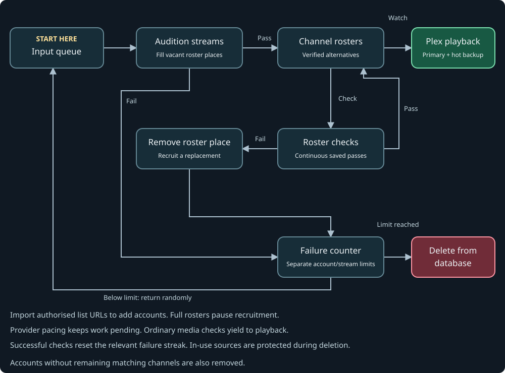

# Antennarr

Bring your authorised IPTV streams into Plex Live TV & DVR. Pick a city, import your Xtream account list, and let Antennarr find and test feeds for each channel. Plex sees each lineup as an HDHomeRun-compatible tuner and supplies its programme guide and recordings.

## Get Antennarr 1.1.0

Docker on Linux is the best-supported installation, on both amd64 and ARM64. The stable release is available as `latest`, `1.1`, or the exact version below.

```sh
docker pull antennarr/antennarr:v1.1.0
```

1. [Start the Docker container](docs/INSTALL.md#start-a-fresh-installation), or install the [macOS or Windows app](docs/NATIVE.md). Desktop downloads include FFmpeg and FFprobe for ARM64 and Intel/AMD processors.
2. Open the web UI and sign in with `admin/admin`. Change the login, then use the first-run wizard to choose a city and import your authorised sources.
3. In Plex **Live TV & DVR**, add the tuner address from the wizard, select the local guide, and map the channels.

Choose from 20 editable city presets, including New York, London, Brussels, Zürich, Buenos Aires, and Bogotá. A fresh installation starts empty. The default port range supports up to six tuners, each with its own Plex address and lineup. [Cities, guides, and tuner setup](docs/MULTI-TUNER.md)

**Upgrading from 1.0?** Download a full backup under **Admin → Backup & restore**. Keep the same appdata, network, port mappings, and Plex addresses when switching images. Restoring 1.0 requires that backup. [Upgrade instructions](docs/INSTALL.md#upgrade)

The original US-only series remains available as **v1.0.9**, its final release, with one tuner and 150 editable channels. [Previous release](https://github.com/fxPPC/Antennarr/releases/tag/v1.0.9)

## How playback works

Antennarr gives channels with the fewest working feeds first pick as it fills their rosters. When Plex tunes a channel, viewers share a primary feed and, when available, a live backup. The web UI shows which channels are ready and which need more sources.



## Project links

- [Docker Hub tags](https://hub.docker.com/r/antennarr/antennarr/tags) and [GitHub releases](https://github.com/fxPPC/Antennarr/releases)
- [Release notes](docs/RELEASE-NOTES.md), [data compatibility](docs/VERSIONING.md), and [1.1 acceptance tests](docs/V1.1-PLAN.md)
- [Build from source](docs/BUILD.md), [contributing](CONTRIBUTING.md), [architecture](docs/ARCHITECTURE.md), [HTTP API](docs/API.md), and [testing](docs/TESTING.md)
- [Setup questions](https://github.com/fxPPC/Antennarr/discussions), [bug reports](https://github.com/fxPPC/Antennarr/issues/new/choose), and [private security reports](https://github.com/fxPPC/Antennarr/security/advisories/new)

Antennarr is licensed under [GPL-3.0-or-later](LICENSE). Images include [third-party notices](docs/licenses/README.md) and corresponding source at `/usr/share/doc/antennarr/source.tar.gz`.
